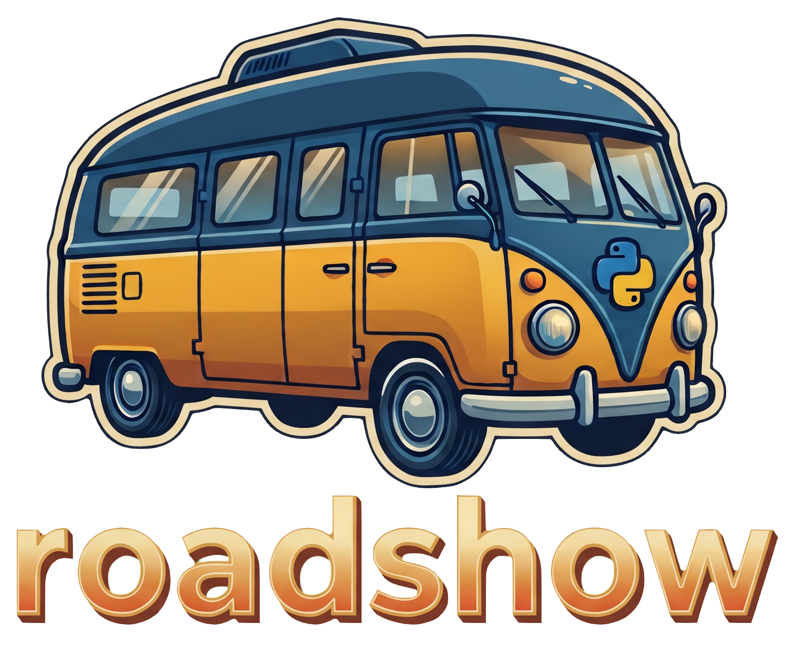

[](https://pypi.org/project/roadshow/)
[](https://www.python.org/)
[](https://github.com/dusktreader/roadshow/actions/workflows/main.yml)
[](https://dusktreader.github.io/roadshow/)



Roadshow makes it easy to demonstrate your project's capabilities in a cli with rich output.

[Documentation](http://dusktreader.github.io/roadshow/)

## Super-quick Start

Requires: Python 3.11 to 3.15

Install through pip:

```shell
pip install roadshow
```


## Documentation

The complete documentation can be found at the
[roadshow home page](https://dusktreader.github.io/roadshow)


## Demo

To see the features in action, you can run the demo in an isolated environment with `uv`:

```shell
uvx --from roadshow roadshow-demo
```
