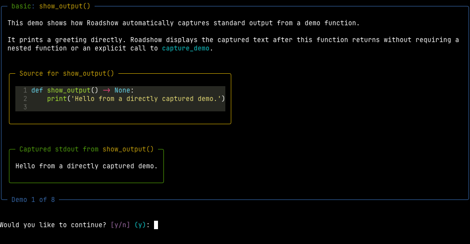

Roadshow makes it easy to demonstrate your project's capabilities in a cli with rich output.

## Overview

Write normal python functions that show how your package's features work. Then, mark those functions with a `@demo`
decorator. Then, run your demo! Roadshow will find all the demo functions, execute them one by one, and show your users
the code, the output, and any exceptions that were thrown.

/// caption
Roadshow in action
///

## Explore

- [Quickstart](quickstart.md)
- [Features](features.md)
- [API reference](reference.md)
